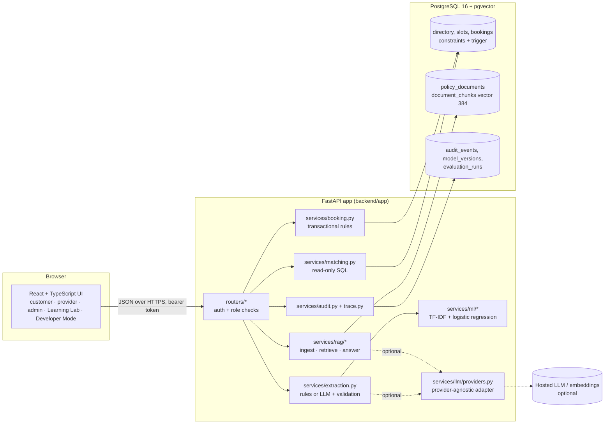
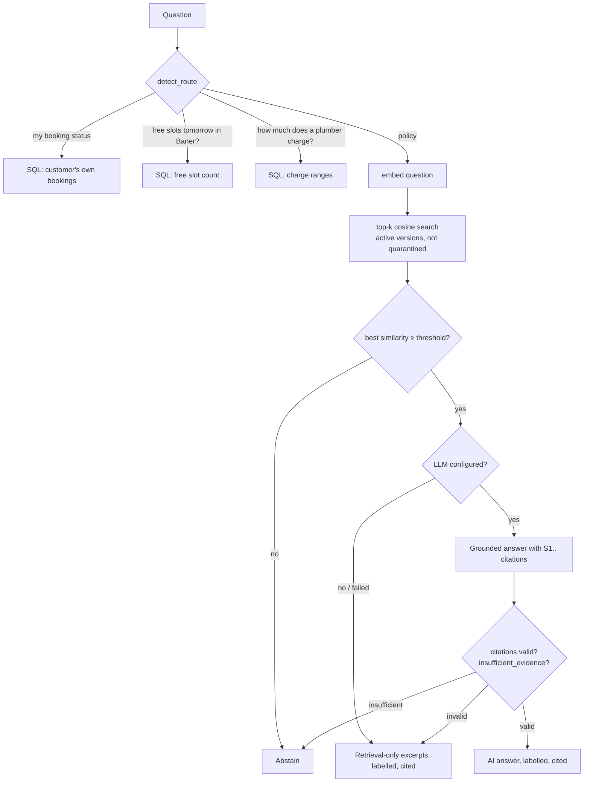
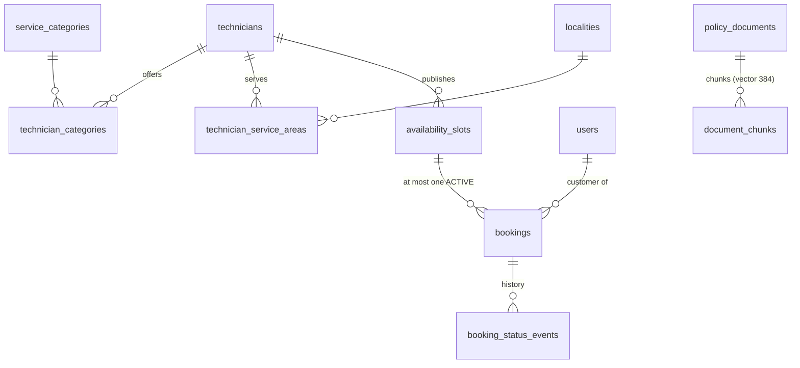

# Architecture

ServiceSaathi AI Lab is one FastAPI application, one PostgreSQL database and one React UI.
No microservices, agent frameworks or orchestration layers. The LLM is an optional helper
that can only *propose* structured fields or *phrase* an answer from retrieved text — it
never touches the database, never creates bookings and never decides availability.

## Components



| Module | Responsibility | Can it write data? |
|---|---|---|
| `extraction.py` | Free text → validated fields with provenance and follow-up questions | No (reads the locality list only) |
| `ml/` | Train, evaluate, load and run the classifier | Only `model_versions` via `registry.py` |
| `matching.py` | Technician + free-slot search, live charge and availability summaries | No |
| `booking.py` / `slots.py` | Booking creation, status transitions, provider slot management | Yes — inside transactions |
| `rag/` | Document ingestion with versions, vector retrieval, grounded answers, routing | Ingestion writes documents/chunks |
| `llm/providers.py` | One `complete_json()` for Anthropic / OpenAI / OpenAI-compatible; embedders | No |
| `audit.py` / `trace.py` | Append-only audit events; in-memory Developer Mode traces | Audit only |
| `evaluation/` | Repeatable suites stored in `evaluation_runs` | Evaluation results only |

## Booking sequence (including a concurrent conflict)

```mermaid
sequenceDiagram
  autonumber
  actor C as Customer
  participant UI as React UI
  participant API as FastAPI
  participant X as extraction + ML
  participant DB as PostgreSQL

  C->>UI: "My kitchen tap is leaking. I need a plumber tomorrow morning in Wakad."
  UI->>API: POST /api/requests/interpret
  API->>X: extract fields, classify category
  X-->>API: fields + provenance (tomorrow → 2026-11-02), missing: none
  API->>DB: SELECT technicians ⨝ categories ⨝ areas ⨝ free slots (read-only)
  DB-->>API: technicians, slots, visiting charges
  API-->>UI: editable summary + technicians with match reasons
  C->>UI: corrects anything, picks a slot, presses Confirm
  UI->>API: POST /api/bookings (Idempotency-Key: k1)
  API->>DB: BEGIN; SELECT slot FOR UPDATE
  Note over API,DB: A second customer confirming the same slot now waits on this row lock
  API->>DB: validate slot/technician/category/locality, check no active booking
  API->>DB: INSERT booking (unique index bookings_one_active_per_slot), INSERT status event, audit
  API->>DB: COMMIT
  API-->>UI: 201 booking SS-XXXXXX (confirmed)
  Note over API,DB: The waiting transaction now sees the booking → 409 slot_taken + fresh alternatives
  UI->>API: retry with same Idempotency-Key k1 (e.g. after a timeout)
  API-->>UI: 201 same booking, replayed = true
```

## Policy question flow



## Data model (simplified)



Rules enforced by the database itself (see `backend/migrations/versions/0001_initial_schema.py`):

| Rule | Mechanism |
|---|---|
| One active booking per slot | Partial unique index `bookings_one_active_per_slot` |
| No overlapping slots per technician | `EXCLUDE USING gist (technician_id WITH =, tstzrange(...) WITH &&)` |
| Fixed one-hour slots on the hour (Kolkata) | `CHECK` constraints |
| Booked technician offers the category / serves the locality | Composite foreign keys to the link tables |
| Booking's slot belongs to its technician | Composite FK `(slot_id, technician_id)` |
| Idempotent submissions | `UNIQUE (customer_id, idempotency_key)` |
| Booked slots cannot be moved, withdrawn or deleted | `protect_booked_slots()` trigger + FK |
| One active version per policy document | Partial unique index `policy_documents_one_active` |
| Provider accounts link to exactly one technician | `CHECK ((role = 'provider') = (technician_id IS NOT NULL))` |

Rules enforced in Python (`booking.py`): slot must be in the future and within 7 days, permitted
status transitions per role, ownership checks, and the 2-hour customer cancellation cut-off.

## Time

All instants are `timestamptz` (UTC on the wire to PostgreSQL via `-c timezone=UTC`). The app's
single clock is `time_utils.now()`, which tests can freeze. Words like "tomorrow" are resolved in
Asia/Kolkata and always shown back as a calendar date the user can change.
